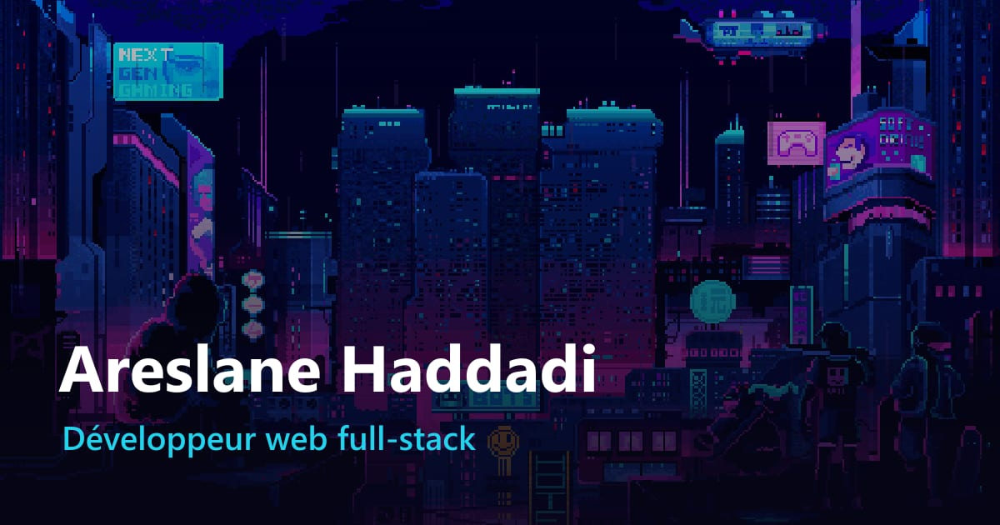

# Portfolio — Areslane Haddadi



**[Voir le portfolio en ligne](https://areslane67.github.io/portfolio-areslane/)** · [English version](https://areslane67.github.io/portfolio-areslane/en/)

Développeur web full-stack, **en recherche d'alternance**.

Ce portfolio présente mon parcours, mes compétences et mes projets. Il intègre une fonctionnalité d'intelligence artificielle : **l'analyse d'offre d'emploi**. Un recruteur colle une offre, et l'IA indique quels projets et compétences de mon profil y correspondent, et ce qui me manque.

## Contenu du site

| Page | Fichier |
|---|---|
| Accueil : présentation courte (un écran) | `index.html` |
| Projets : liste avec aperçu au survol | `projets.html` |
| À propos : présentation, compétences, parcours | `a-propos.html` |
| Contact : coordonnées et analyse d'offre par IA | `contact.html` |
| Fiches projets détaillées (contexte, problème, démarche, outils, résultat) | `projet-five-cup.html`, `projet-brainburst.html`, `projet-budget-tracker.html`, `traveaux1.html` (Java), `traveaux2.html` (PHP) |
| TP web 2020 – 2024 | `traveaux.html` |
| Version anglaise de toutes les pages | `en/` |
| CV en PDF (généré depuis `cv/cv-source.html`) | `assetWeb/CV.pdf` |

## Architecture

```
Navigateur ──► GitHub Pages (site statique : HTML, CSS, JavaScript)
    │
    └─ js/analyse.js ──POST /api/analyse──► Vercel (fonction serverless Node.js)
                                                 │  clé ANTHROPIC_API_KEY (variable d'environnement)
                                                 └──► API Claude (Anthropic)
```

- **Site statique** (GitHub Pages) : rapide, gratuit, sans serveur à maintenir.
- **Fonction serverless** (`api/analyse.js`, hébergée sur Vercel) : c'est le seul endroit qui connaît la clé d'API. Le navigateur n'y a jamais accès, et elle n'est pas dans le dépôt.
- **IA** : API Claude d'Anthropic, appelée avec le SDK officiel `@anthropic-ai/sdk`.

## La fonctionnalité IA : analyse d'offre

| Fichier | Rôle |
|---|---|
| `api/analyse.js` | Reçoit l'offre, la vérifie, appelle l'IA, vérifie la réponse, gère les erreurs |
| `api/_prompt.js` | Prompt système (les règles de l'IA) et format JSON imposé à la réponse |
| `api/_profil.js` | Le contexte donné à l'IA : mon profil tel qu'il est publié sur le site |
| `js/analyse.js` | Formulaire, appel à l'API, affichage du résultat et des messages de repli |
| `docs/prompt-systeme.md` | Explication de chaque règle du prompt |
| `docs/tests-ia.md` | Jeu de tests et résultats |

**Choix et garde-fous :**
- **Contexte maîtrisé** : l'IA ne reçoit que le contenu de `api/_profil.js`. Le prompt lui interdit d'inventer une compétence et l'oblige à lister ce qui manque.
- **Réponse structurée** : la réponse est un JSON au format imposé (*structured outputs*). Le site l'affiche avec `textContent`, sans jamais insérer de HTML venant de l'IA.
- **Injection de prompt** : le texte de l'offre est placé entre balises `<offre>` et le prompt indique de ne jamais suivre les consignes qu'il contient.
- **Mention IA et repli** : chaque réponse est signalée comme générée par une IA. En cas d'erreur, de refus ou de texte qui n'est pas une offre, un message clair s'affiche avec un lien de contact. Si le service ne répond pas, la section reste masquée.
- **Coût limité** : l'offre est limitée à 6 000 caractères (vérifiés avant l'appel, donc gratuits). La réponse est plafonnée à 8 000 tokens et le format est court. On compte au plus 5 analyses par adresse IP toutes les 10 minutes. Le prompt système est mis en cache.
- **Confidentialité** : l'offre n'est ni stockée ni écrite dans les journaux. Le site demande de ne pas y mettre de données personnelles. Le profil donné à l'IA ne contient aucune donnée personnelle.

## Installation en local

Prérequis : Node.js 20 ou plus.

```bash
git clone https://github.com/areslane67/portfolio-areslane.git
cd portfolio-areslane
npm install
```

- **Le site** : ouvrir `index.html` avec un serveur local, par exemple l'extension *Live Server* de VS Code.
- **L'analyse d'offre en local** : il faut une clé d'API Anthropic.

```bash
# PowerShell
$env:ANTHROPIC_API_KEY = "ta-cle"
node scripts/serveur-api-local.js
```

Ouvrir ensuite la page Contact avec le paramètre `?api=http://localhost:5600/api/analyse` (par exemple `contact.html?api=http://localhost:5600/api/analyse`).

## Mise en ligne de l'analyse d'offre (Vercel)

1. Sur [vercel.com](https://vercel.com), choisir **Add New… → Project** et importer le dépôt GitHub `portfolio-areslane`.
2. Laisser le préréglage **Other**, sans commande de build.
3. Dans **Environment Variables**, ajouter `ANTHROPIC_API_KEY` avec la clé créée sur [console.anthropic.com](https://console.anthropic.com).
4. Cliquer sur **Deploy**. L'API est alors disponible à `https://portfolio-areslane.vercel.app/api/analyse`. Si Vercel attribue une autre adresse, la reporter dans `API_PAR_DEFAUT` (`js/analyse.js`).
5. Dans la console Anthropic, fixer une **limite de dépenses mensuelle**.

Réglages optionnels (variables Vercel) :
- `AI_MODEL` : modèle utilisé, `claude-opus-5-5` par défaut.
- `AI_EFFORT` : `low`, `medium` (défaut) ou `high`.
- `ALLOWED_ORIGINS` : autres sites autorisés, séparés par des virgules.

## Tests

```bash
node scripts/test-ia.js                                    # contre l'API en ligne
node scripts/test-ia.js http://localhost:5600/api/analyse  # contre l'API locale
```

Le script envoie 14 cas (offres variées, texte hors sujet, injection de prompt, limites de taille…). Il écrit les réponses dans `docs/resultats-tests.md`, à compléter par une appréciation manuelle. Voir `docs/tests-ia.md`.

## Crédits

- Illustration pixel art de l'accueil : Pixel Jeff.
- Logos des technologies (`img/tech/`) : [Devicon](https://devicon.dev) (licence MIT), sauf phpMyAdmin et XAMPP : [Simple Icons](https://simpleicons.org) (CC0).
